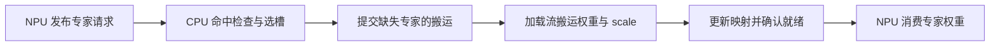

# 让 NPU 少等专家：单卡 MoE 卸载的 Host 与搬运优化

把冷专家放到 DRAM、把热专家留在 HBM，可以降低 MoE 模型的设备内存需求。但专家卸载的性能还取决于另一件事：**NPU 需要权重时，CPU 能否及时决定搬什么，并持续把搬运任务送到设备。**

一次专家加载涉及缓存查询、槽位选择、任务交接、拷贝提交和就绪确认。即使实际传输速度很快，这些环节之间的等待仍可能让加载流出现空泡。我们的优化围绕这条路径展开：让专家管理更轻、让 CPU/NPU 交接更直接，并让搬运提交摆脱 Python/GIL 的阻塞。本文介绍的是保留原有 MTE 交接协议的 C++ 更新方案。

## 工作负载：有限 HBM 中的冷热专家管理

目标场景是 Ascend 950DT / 950PR 单卡运行 DeepSeek-V4-Flash，Prefill 与 Decode 共部署。参考配置如下：

| 项目 | 配置 |
| --- | --- |
| 并行与请求 | TP=PP=DP=1，单并发；5 个输入 token，输出 5 或 128 token，temperature=0 |
| Decode 执行 | 图执行，参考捕获尺寸 [1,2,3]；MTP 预测数为 2 |
| 专家规模 | 43 个 MoE 层，每层 256 个路由专家、1 个共享专家；路由 TopK=6 |
| Decode 缓存 | 每层 24 个可替换的路由专家槽，共 1032 个槽；采用 LRC 策略 |
| 预取 | 预测下一层专家，每次最多提前加载 1 个缺失专家 |
| Prefill 专家池 | 2 个可复用层池，每个可容纳一层的 256 个专家 |
| 软件基线 | CANN 9.1.0，Torch / torch-npu 2.10 系列 |

这意味着每层只有约 9.4% 的路由专家能放在 Decode 缓存中。缓存命中可以直接复用权重；未命中则需要从 Host 源缓冲加载，预取用于把其中一部分工作提前进行。

DT 的资源基线中，设备可见 HBM 为 91.75 GiB，驻留模型权重为 **33.63 GiB**，启动内存评估的 **peak activation 为 1.62 GiB**，**KV cache 预分配为 47.20 GiB**；Host 专家源权重及量化参数的逻辑存储合计 **137.0625 GiB**。Peak activation 包含 Prefill 内存评估，不能理解为每个 Decode 步固定占用的内存；这些容量数值描述 DT 基线。

单个“层、专家”的权重及 scale 共 **12.75 MiB**。一条 5-token 诊断请求中，按需缓存命中率为 **65.67%**，Decode 仍发生 108 次预取加载和 552 次按需加载，累计约 **8.22 GiB**。因此，减少专家管理和搬运之间的停顿，对短输出也有实际价值。

## 专家管理要足够轻，才能让预取发挥作用

专家卸载的 CPU 工作不只是调用一次 memcpy。它需要检查哪些专家已在 HBM、选择被替换的槽位，并更新访问统计。如果这些工作逐层累积，预取请求即使已经到达 CPU，也不能立即开始搬运。

LRC 的统计更新和选槽逻辑适合放入 C++：保持缓存算法和专家选择规则，将高频循环、容器操作及策略计算从 Python 热路径移出。实际模型中的局部耗时如下：

| 策略工作 | Python | C++ | 耗时降低 |
| --- | ---: | ---: | ---: |
| 按需 LRC 计算 | 55.70 μs | 12.33 μs | **77.9%** |
| 预取选槽 | 33.11 μs | 6.10 μs | **81.6%** |

同样需要避免在正式推理中承担不必要的 debug 工作。在保持 Python LRC 的对照中，仅关闭 debug，PR 的 5-token Decode 就由 **237.410 降至 190.485 ms**，降低 **19.77%**；128-token 由 **7709.594 降至 7038.659 ms**，降低 **8.70%**。

这两项解决的是不同成本：C++ 降低必要策略工作的执行开销，关闭 debug 去掉非必要工作。将它们分开验证，才能判断收益来自哪里。策略函数变快也不保证所有请求都同比例加速，整体效果还取决于计算、加载与等待能否重叠。

## 用共享状态交接任务，把等待放到真正消费权重的位置

预取的价值在于提前做事。如果设备刚发布预取就立即等待完成，传输很难与模型计算重叠。有效的组织方式是：**提前发布专家请求，让 CPU 准备和搬运；设备继续推进计算，直到需要使用这些权重时才严格等待。**

MTE 共享内存方案用请求和完成状态连接 CPU worker 与 NPU。CPU 不再依赖运行时 Host 回调来获得每次任务，而是读取共享请求、执行更新，再发布完成状态。消费者仍然需要确认权重就绪，优化的是交接成本和等待位置，并没有放松正确性约束。

在 LRC 已为 C++、debug 均关闭的条件下，将回调交接替换为 MTE 默认交接，PR 的性能变化为：

| 输出长度 | 回调交接 Decode | MTE 交接 Decode | 降低 |
| --- | ---: | ---: | ---: |
| 5 token | 172.622 ms | 144.026 ms | **16.57%** |
| 128 token | 7195.463 ms | 6268.793 ms | **12.88%** |

交接线程本身也应尽量轻量：只扫描已分配槽位，用原子读取替代加锁探测，并保留 yield。这组轮询优化的附加 Decode 收益约为 1.4%～1.6%，复测中也存在不改善情况；主要收益仍来自交接路径和计算重叠方式。

加载侧采用普通流来降低提交开销。预取和按需的 copy_submit 分别由 **135.09/585.12 μs** 降至 **37.04/180.60 μs**。但按需“提交＋同步”只由 **1427.93 降至 1400.44 μs**，说明提交区间变短可能伴随等待位置变化，必须结合模型时延评价。

## 持续提交搬运：同时解决 GIL 和 scale 布局

更快的任务交接，还需要更顺畅的搬运提交。

一个专家的权重、scale 等字段会形成多项任务。设备执行完前面的任务后，后续任务必须已经进入队列；否则加载流就会空等。Python 对象处理、逐字段提交和 GIL 竞争，都可能使提交线程停顿。只把 LRC 改成 C++，还不能消除这条路径上的 Python 依赖。

因此，原生更新把**专家规划、地址选择、ACL 异步搬运提交、同步和映射更新**放进 C++ worker。Decode 更新热路径不调用 Python，也不获取 GIL；初始化和图注册仍由 Python 完成。eager/prefill 则通过预登记地址和整批 C++ 提交，减少逐字段的 Python 工作。

scale 的物理布局必须一并处理。即使逻辑形状和数值相同，CPU 源张量与 NPU 目标张量的实际排列也可能不同，直接走 Tensor 拷贝就可能触发布局转换。解决方式是在权重加载时直接准备目标 dtype 和物理排列，运行时按字节搬运，并让各条路径复用同一份源缓冲。

这一设计带来两项可观察的效果：

- 加载流上的 Transpose 任务从 **832 个降至 0 个**，与 scale 直接字节搬运的预期一致。
- 无须额外长期保留一份转换后的 scale，取消 **8.0625 GiB** 重复缓冲。

在保持 MTE 交接与缓存条件相同的 5-token 对照中，完整 C++ 提交方案的性能如下：

| 指标 | Python 更新与提交 | C++ 更新与提交 | 耗时降低 |
| --- | ---: | ---: | ---: |
| Decode | 150.563 ms | 137.063 ms | **8.97%** |
| TPOT | 37.641 ms/token | 34.266 ms/token | **8.97%** |
| TTFT | 2958.781 ms | 2823.885 ms | **4.56%** |
| 完整请求 | 3109.474 ms | 2961.070 ms | **4.77%** |

相同对照的 profile 中，Host 更新任务均值由 **2279.559 降至 643.141 μs**，加载准备与提交由 **194.969 降至 136.535 μs**。前者包含同步等待，不能把全部差额解释成 GIL 时间；实际收益来自 C++ 执行、提交方式和布局准备的共同作用。

短输出尤其需要同时关注 TTFT：仅优化 Decode 的实现曾出现首 token 变慢、抵消 Decode 收益的情况。这也是将批量提交覆盖到 eager/prefill 的原因。本文的 C++ 整体收益采用输出一致的 5-token 结果；128-token 的 Python/原生版本输出一致性尚未通过，不作为已验证收益。

## 理解并行等待：Host 函数更短，间隔也可能更长

预取 Host 工作与设备计算是并行的。设备计算可能先完成，也可能晚于预取结束。如果 CPU 提前完成预取，而设备还在计算，预取→按需间隔就会包含剩余计算等待。

这意味着，**函数间隔不是纯粹的调度开销**。在 C++ 提交方案的对照中：

| 同一 Host 时间轴上的范围 | Python 更新 | C++ 更新 |
| --- | ---: | ---: |
| 预取 Host 函数 | 1086.518 μs | 262.481 μs |
| 预取结束→按需开始 | 109.904 μs | 261.169 μs |
| 预取开始→按需开始 | 1196.422 μs | 523.650 μs |

单看中间一行会认为间隔恶化；把前一个函数纳入后，这段总跨度实际缩短了约 **56.23%**。优化让 CPU 更早完成工作，也会让原先被 Host 工作覆盖的计算等待显露出来。

为观察这一影响，可以保留原间隔，再分别计算“去掉明确晚完成样本”和“扣除暴露计算等待”两种结果。对齐时间线上的 PR MTE 组合分析如下：

| 输出长度 | 计算晚于预取结束的占比 | 原始间隔 | 去掉明确晚完成样本 | 扣除计算等待后的估算 |
| --- | ---: | ---: | ---: | ---: |
| 5 token | 42.86% | 111.080 μs | 53.010 μs | 41.665 μs |
| 128 token | 31.28% | 80.208 μs | 40.470 μs | 36.557 μs |

其他样本保留原值。对应 C++ LRC 回调的扣除后间隔为 **111.893/118.514 μs**，MTE 组合分别低 **62.76%/69.15%**。这是对等待来源的分析，不能作为额外的 Decode 加速。晚完成样本中的预取零加载只占 **27.78%/24.93%**，所以计算等待并不只发生在空载回调中。

用同次 profile 进一步假设 Host 间隔全部可消除，可以得到 Miracle TPOT：PR 的 5-token 从 **39.138 估算为 34.294 ms/token**，128-token 从 **51.264 估算为 46.009 ms/token**，潜在降幅约 **12.38%/10.25%**。这个估算要求间隔都处于关键路径且能够消除，用于判断优化空间，不是实测收益。

## 整体收益：模型时延、Host 交接与加载流空泡

下面分别呈现模型时延、Host 交接间隔和加载流空泡。软件管理与搬运优化相互配合，但局部时延不能相加推算请求收益。

### 模型时延

“回调基线”采用 Python LRC 并开启 debug；“MTE 优化”包含 C++ LRC、关闭 debug、共享内存交接及轮询优化，权重提交仍由 Python/Torch 执行。该比较用于展示组合效果；C++ 提交的附加收益由前面的独立对照给出。

| 平台 / 输出 | 完整请求：回调 → MTE | 降低 | TPOT：回调 → MTE | 降低 |
| --- | ---: | ---: | ---: | ---: |
| DT / 5 token | 4147.959 → 3967.276 ms | **4.36%** | 130.424 → 82.478 ms/token | **36.76%** |
| PR / 5 token | 3715.844 → 3545.236 ms | **4.59%** | 59.352 → 35.508 ms/token | **40.17%** |
| PR / 128 token | 11163.819 → 9614.656 ms | **13.88%** | 60.705 → 48.588 ms/token | **19.96%** |

PR 的 Decode 对应为 **237.410→142.033 ms** 和 **7709.594→6170.634 ms**。短输出中，首 token 前处理占完整请求的大部分，因此 Decode/TPOT 的改善比完整请求降幅更明显。DT 的完整请求与 TPOT 为相同配置下的独立测量。

### Host 交接间隔

| 平台 / 输出 | 预取→按需：回调 → MTE | 按需→下一层预取：回调 → MTE |
| --- | ---: | ---: |
| DT / 5 token | 226.336 → 57.606 μs | 210.833 → 80.845 μs |
| PR / 5 token | 175.729 → 111.080 μs | 153.301 → 55.387 μs |
| PR / 128 token | 119.002 → 80.208 μs | 131.608 → 57.777 μs |

DT 为 3×IQR 后均值，PR 为原始均值。C++ 提交对照中，按需→下一层预取又由 **92.035 降至 34.642 μs**；预取→按需则需要结合前述计算重叠解释。

### 加载流空泡

加载流空泡按同流全部任务的占用区间统计，MEMCPY、Transpose 均算占用。下表为全采集窗口中 `10 ≤ gap < 5000 μs` 的平均空档。

| 比较对象 | 优化前 | 优化后 | 降低 |
| --- | ---: | ---: | ---: |
| DT / 5 token，回调 → MTE | 1531.104 μs | 654.492 μs | **57.25%** |
| PR / 5 token，回调 → MTE | 967.931 μs | 351.388 μs | **63.70%** |
| PR / 128 token，回调 → MTE | 709.510 μs | 379.594 μs | **46.50%** |
| PR / 5 token，MTE Python 提交 → C++ 提交 | 1319.490 μs | 645.536 μs | **51.08%** |

空泡衡量加载流上的等待，不等于整卡空闲，也不包含被阈值排除的长短间隔。C++ 提交对照中，可关联的按需→下一层预取空泡由 **1289.862 降至 75.779 μs**，说明持续提交的间隔明显缩短，但没有完全消失。

性能数值均来自各自同机、同负载对照；不同平台和不同基线的收益不叠加。正式请求预热 5 次、测量 20 次，关闭 profiler/MSTX；局部分析使用独立 profile。Decode 定义为首个至最后内容输出的经过时间，TPOT 按实际输出 token 数计算。整套设计的着力点，是让策略、交接和搬运提交更及时地推进，使专家预取真正转化为较少的设备等待。
